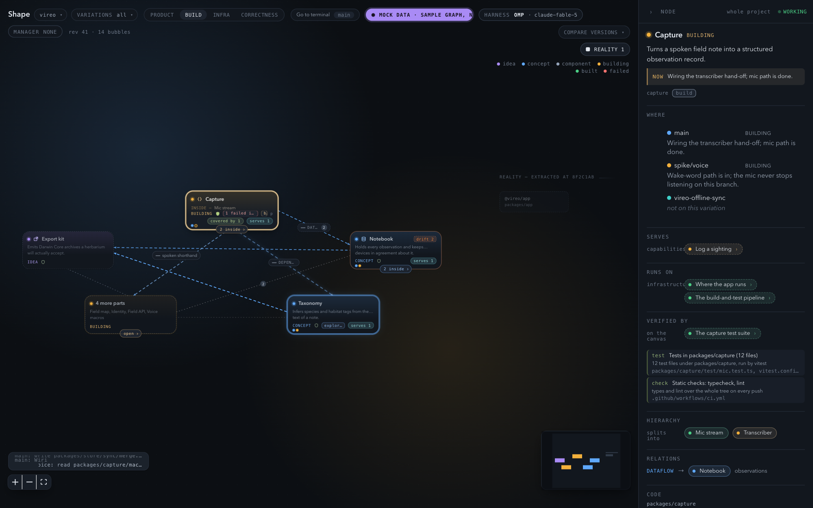

# Shape

Shape turns a real repository into an explorable picture of the product and the code behind it.
A model maintains the committed **intent** map—what each part promises—while Shape derives
**reality** from the repository and shows **drift** where the two disagree. Current coding sessions
can add live activity and an explicitly uncommitted semantic overlay.

The canvas is a read surface, not an agent console. Use it to move between product capabilities,
code, infrastructure, and checks; keep directing agents in the coding harness where they run.



## Try Shape on your repository

Start your coding harness **in the repository you want to map**, then paste this single instruction:

```text
Install https://github.com/orrgal1/shape for the repository I am in, following its docs/onboarding.md. Keep this repository as the target, clone Shape separately, discover or start a server, and complete a semantic map of main without changing my working tree. Finish with the verified canvas URL and a short usage guide.
```

The detailed guides carry the serve, authentication, mapping, and recovery rules. The Shape
checkout and target repository stay separate, and the original repository path remains fixed.

## Requirements and manual installation

- [Node 26 or newer](https://nodejs.org/en/download), [pnpm 11](https://pnpm.io/installation), Git, and a coding harness that loads skills.
- pnpm is pinned by `packageManager`, but Node 26 does not bundle Corepack. Install pnpm 11
  separately, or install Corepack before enabling it.

For manual installation, run this where you keep tools, **not** inside the target repository:

```bash
git clone https://github.com/orrgal1/shape.git /absolute/path/to/stable-shape
cd /absolute/path/to/stable-shape
pnpm install --frozen-lockfile
pnpm --filter @shape/web build
```

Still in `/absolute/path/to/stable-shape`, install all three skills for your harness:

```bash
pnpm shape install omp                         # OMP only
# pnpm shape install claude                    # Claude Code only
# pnpm shape install                           # both standard roots
# pnpm shape install --custom-dir /path/skills # another harness only
```

The installer copies `shape-serve`, `shape-map`, and `shape-live` and records the absolute path to
that checkout's [`scripts/shape.mjs`](scripts/shape.mjs). It does **not** install a global `shape`
executable. Keep the checkout in place. If it must move, remove or move its old managed skill
directories before installing from the new path; the installer refuses to overwrite same-name
skills owned by another checkout. See [`skills/README.md`](skills/README.md) for roots and options.

Switch back to the repository you want to use:

```bash
cd /absolute/path/to/target-repository
```

The next three phrases are **coding-harness prompts**, not shell commands.

## The three-step workflow

### 1. Serve or connect

> **Harness prompt:** `shape serve`

The serve skill discovers saved, configured, explicit, and loopback candidates before offering to
connect or start anything. It verifies Shape health and control access, keeps a started service in
the foreground under harness supervision, and returns the real credential-free canvas URL.

For a new local server, the default canvas URL is `http://127.0.0.1:4400`; use the URL the wizard
actually returns. Port 5173 belongs to the Vite development UI, not the normal production setup.

### 2. Map a committed branch

> **Harness prompt:** `shape map`

With no branch named, mapping targets local `main`. It resolves that branch to an exact commit and
creates an immutable snapshot without switching your checkout. Dirty, staged, and untracked files
are not folded into the committed map.

For feature work, map that named branch before live reporting:

> **Harness prompt:** `shape map feature/payments`

There is no need to check out `main`, stash work, or clean the working tree. A branch argument means
that local branch's committed tip, regardless of the currently checked-out branch.

The harness inspects the snapshot, prior committed document, Git diff, and mechanically extracted
reality, then authors grounded semantic operations. Shape selects:

- **initial** for the first committed map of that repository branch;
- **incremental** when the prior mapped commit is available and is an ancestor of the new tip;
- **full** when missing, rebased, divergent, or otherwise unverifiable history makes a delta unsafe.

Preparation alone is not a map. Only a successful atomic finish updates the branch's committed
semantic document and mapped-commit checkpoint. Transaction and recovery details are in
[`docs/onboarding.md`](docs/onboarding.md).

### 3. Report this session live

> **Harness prompt:** `shape live`

Live reporting attaches to the repository's **currently checked-out named branch**, which must
already have a committed map. The skill explicitly starts, emits meaningful work/idle transitions,
files, tools, and evidence-backed semantic changes, then stops with the retained session handle.

> **Harness prompt, when done:** `Stop shape live reporting for this session.`

Live activity is transient. Live semantic operations form an uncommitted overlay: they advance the
visible effective revision but never rewrite the committed map or advance its checkpoint. Stopping
clears session/activity state; semantic overlay changes remain visibly uncommitted until a later
successful map commit replaces or reconciles them.

After committing your code changes, ask the harness to run `shape map <branch>` again to update the
committed map.

## Using the canvas

A project is a repository and its branches are canvas variations. Worktrees route coding sessions;
they are not competing project or branch identities.

- Use the project switcher and branch selector to move between repositories and mapped branches.
- Drill from product capabilities into build, infrastructure, and correctness. Bubble details show
  claims, code references, reality, drift, revisions, and live activity.
- Mapping or activity adds a project to the registry. When supported by a connected agent, the
  project menu can also add an existing Git repository for observation.
- **Mark inactive** stops watching and closes the room without deleting its map, revisions, or
  registry entry. **Show inactive** and **make active** reopen it later. Mapping and live updates
  are rejected while the project is inactive.


## State and storage

Durable maps, checkpoints, revisions, live effective state, and the project registry live in the
selected Shape server's database. For the default local service that is
`~/.shape/server/shape.db`; `--data-dir <directory>` uses `<directory>/shape.db`.

Client-side state stays on the machine invoking Shape:

- `~/.shape/servers.json` stores selected endpoints and credentials with private permissions.
- Mapping preparations and live recovery handles live under Shape's home.
- `SHAPE_HOME` must be absolute and changes the parent of `.shape`;
  `SHAPE_HOME=/srv/shape-state` means state under `/srv/shape-state/.shape`.

Canvas state stays out of the target repository's working tree.

## Remote use and authentication

- A started server remains a supervised foreground process, not a detached daemon.
- A non-loopback listener requires authentication. Send remote credentials only through HTTPS/WSS
  behind a trusted TLS reverse proxy, or through a supervised SSH tunnel to a loopback server.
  Shape does not terminate TLS itself.
- Never put a token in a shared or copied URL, chat, or output. Saved CLI credentials authorize
  control clients, not a fresh browser. If prompted, enter the token directly in the canvas form
  and continue sharing only the clean URL.

See [`docs/onboarding.md`](docs/onboarding.md) for the complete trust and connection flow.

## Architecture

Your harness reads the repository and sends map and activity updates to the Shape server. The
server persists those updates and streams them to the browser; a remote server does not need a
checkout of the repository.

The portable workflow is explicit. Existing OMP or Claude adapters may report native activity when
their extension, MCP server, or hooks were configured and loaded before the session started.
Installing skills does not configure those adapters or retrofit hooks into a running process; use
explicit `shape live` for the current session.

[herdr](https://github.com/orrgal1/herdr) is optional. Shape can use an existing herdr session for
discovery and **go to terminal** focus. Ordinary serve/map/live and manager attachment do not open
target coding tabs or launch target coding sessions. Issue work remains in the optional
[manager skill](https://github.com/orrgal1/manager-skill), not the canvas.

## CLI, development, and docs

[`scripts/shape.mjs`](scripts/shape.mjs) is the helper entrypoint used by installed skills and
operators. It exposes `serve`, `map`, `live`, and `install`; map subcommands are transaction helpers
and do not invent semantic meaning.

From the stable Shape checkout:

```bash
cd /absolute/path/to/stable-shape
pnpm shape --help
```

From any other working directory:

```bash
node /absolute/path/to/stable-shape/scripts/shape.mjs --help
```

- [`docs/onboarding.md`](docs/onboarding.md) — serve → map → live operation and recovery.
- [`skills/README.md`](skills/README.md) — skill roles, install targets, and checkout behavior.
- [`packages/link/README.md`](packages/link/README.md) — optional native adapters.
- [`CONTRACTS.md`](CONTRACTS.md) — runtime and wire contracts; the machine-readable source is
  [`packages/shared/src/index.ts`](packages/shared/src/index.ts).
- [`docs/vision.md`](docs/vision.md) — original product direction and retained boundaries.
- [`CONTRIBUTING.md`](CONTRIBUTING.md) — development setup, checks, conventions, and review.
- [`SECURITY.md`](SECURITY.md) and [`CODE_OF_CONDUCT.md`](CODE_OF_CONDUCT.md).

## Third-party

Geometry helpers in
[`packages/web/src/canvas/vendor/archify-geometry.ts`](packages/web/src/canvas/vendor/archify-geometry.ts)
and glyph data in [`packages/web/src/canvas/kind.tsx`](packages/web/src/canvas/kind.tsx) are adapted
from [archify](https://github.com/tt-a1i/archify) at commit `5de7275`, under MIT. Attribution and the
upstream notice remain in source. Runtime dependencies are declared in package manifests.

## License

MIT — see [`LICENSE`](LICENSE).
